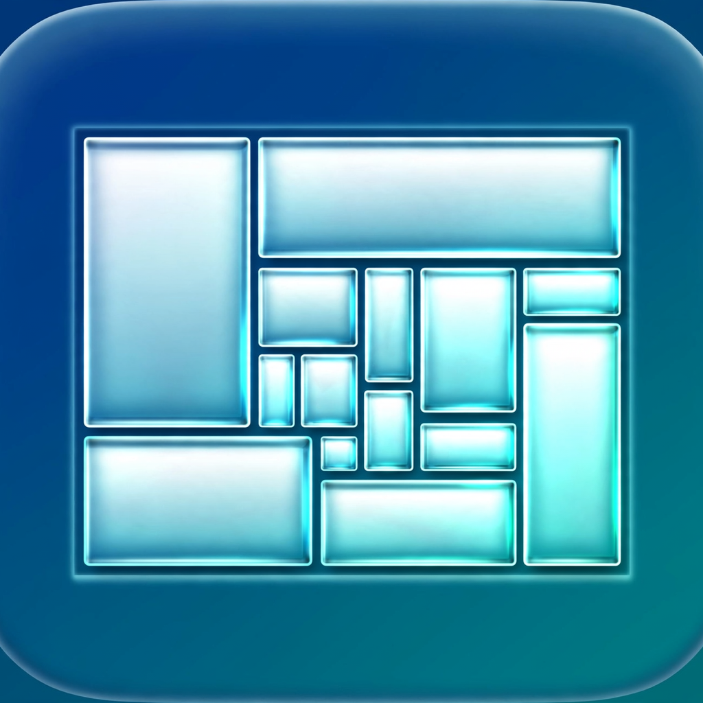

# MacOSWindowsManager

**Version 1.1 (build 4)** · macOS 14+ · Native Swift · No account, no pay tier, no network



Your own native Swift window manager for macOS — inspired by TrellisWM's
*dock, nest, and zoom* idea, built clean-room for local, personal use.
It lives in the menu bar; choose **About MacOSWindowsManager** there for
the built-in explainer.

One display works; two displays each keep their own independent layout.

## Build & run

```bash
xcodegen generate
xcodebuild -scheme MacOSWindowsManager -configuration Debug build
# Or open the generated project:
open MacOSWindowsManager.xcodeproj
```

On first launch, grant **Accessibility** (System Settings → Privacy &
Security → Accessibility → enable MacOSWindowsManager). That permission
is how any app moves/resizes another app's windows. Screen Recording is
optional and not used in v1.

## What it does

- **Stable automatic tiling (default):** per display, the arranger only
  ever produces a full window, two halves, one half + two quarters, or
  four quarters — the arrangements that stay readable. A fifth window
  never subdivides further; it tabs behind a similar window's tile and
  is promoted into a real slot when a visible window closes.
- **App-aware pairing:** similar apps sit side by side (two browsers
  together). With two browsers open, a new messaging window takes a
  quarter and the primary browser keeps its full half.
- **No rearrangement churn:** windows keep their slots. Clicking or
  focusing never moves anything — layouts change only when a window
  opens, closes, or moves display, and even then the primary window
  keeps its tile and at most one pairing swap happens. Small displays
  cap at halves (a quarter smaller than ~440×300 pt is never produced);
  portrait displays stack halves vertically.
- **Mission Control & Spaces are left alone:** tiling and drag-to-dock
  suspend while Mission Control/Exposé is on screen, only windows on
  the current Space are arranged, and arriving on a desktop adopts
  its windows as-is. Looking around never rearranges anything.
- **Layouts:** Stable, BSP (manual nesting), Master+Stack, Columns,
  Grid (menu or hotkeys). Every layout now respects a minimum readable
  tile size instead of dividing into slivers.
- **Float All** restores every window to its pre-tiling position;
  quitting does the same. Nothing gets lost off-screen.
- **Saved views** 1–3 from the menu; **excluded apps** are never arranged.
- **Multi-monitor:** each `NSScreen` gets its own layout; move the
  focused window across displays with ⌃⌥D.

## Hotkeys (⌃ = Control, ⌥ = Option)

| Keys | Action |
|---|---|
| ⌃⌥Space | Overview — tile everything, see it all |
| ⌃⌥F | Float all (restore originals) |
| ⌃⌥↩ | Maximize / zoom into focused window |
| ⌃⌥↓ / ⌃⌥↑ | Zoom in / step back out |
| ⌃⌥[ / ⌃⌥] | Back / forward |
| ⌃⌥Y / ⌃⌥T | Next tab / tear tab off |
| ⌃⌥- / ⌃⌥= | Shrink / grow seam |
| ⌃⌥Tab | Focus next window |
| ⌃⌥D | Move focused window to next display |
| ⌃⌥S / B / M / C / G | Stable / BSP / Master / Columns / Grid |
| ⌃⌥⇧1, ⌃⌥1–3 | Save view 1 / restore view 1–3 (per display) |

## Architecture

- `Models/StableLayout.swift` — pure halves/quarters planner, app
  classifier/pairing, and the slot-stability rules (unit-tested).
- `Models/LayoutTree.swift` — pure BSP tree (manual docking/tabs/seams)
  + frame solver for the legacy layouts (unit-tested, no Accessibility
  dependency) and Cocoa↔AX coordinate conversion.
- `Services/AXWindowService.swift` — Accessibility enumeration (one
  batched attribute fetch per window), frame get/set, focus/raise.
- `Services/TilingManager.swift` — per-display grouping, window-set
  fingerprint (focus clicks are no-ops), 360 ms animated layout
  motion, original-frame capture, saved views.
- `Services/HotkeyManager.swift` — Carbon global hotkeys.
- `AppDelegate.swift` — menu-bar shell, workspace/display observers.

## Tests

```bash
xcodebuild -scheme MacOSWindowsManager test
```

## Trellis moves (implemented on the tree)

- **Drag-to-dock:** drag a window onto another window's center to tab
  it, onto its edge to dock beside it, or to a screen edge to dock
  beside everything on that display (live preview overlay).
- **Seam resize:** drag the gap between two windows, or ⌃⌥-/=.
- **Tab groups:** windows sharing one tile; ⌃⌥Y cycles tabs,
  ⌃⌥T tears the active tab off into its own tile.
- **Zoom/overview:** ⌃⌥Space shows everything, ⌃⌥↓ zooms into the
  focused window, ⌃⌥↑ steps back out, ⌃⌥[ / ] go back/forward.
- **Saved views:** ⌃⌥⇧1 saves, ⌃⌥1/2/3 restores — per display,
  persisted across launches.

Still out of scope: pinch gestures and live ScreenCaptureKit previews
during motion (windows animate as real windows instead).
